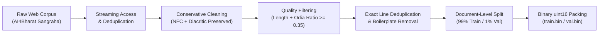
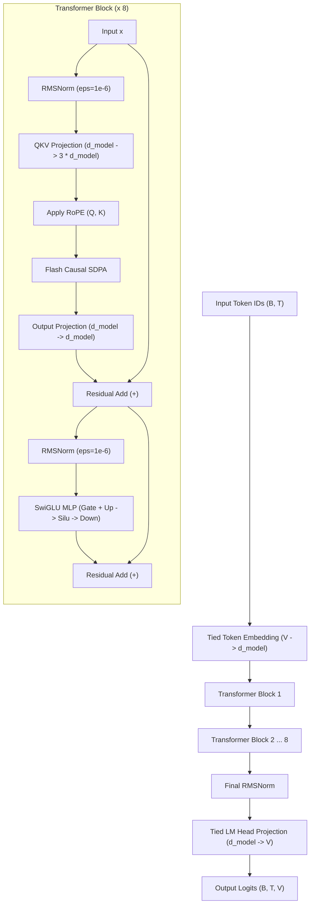
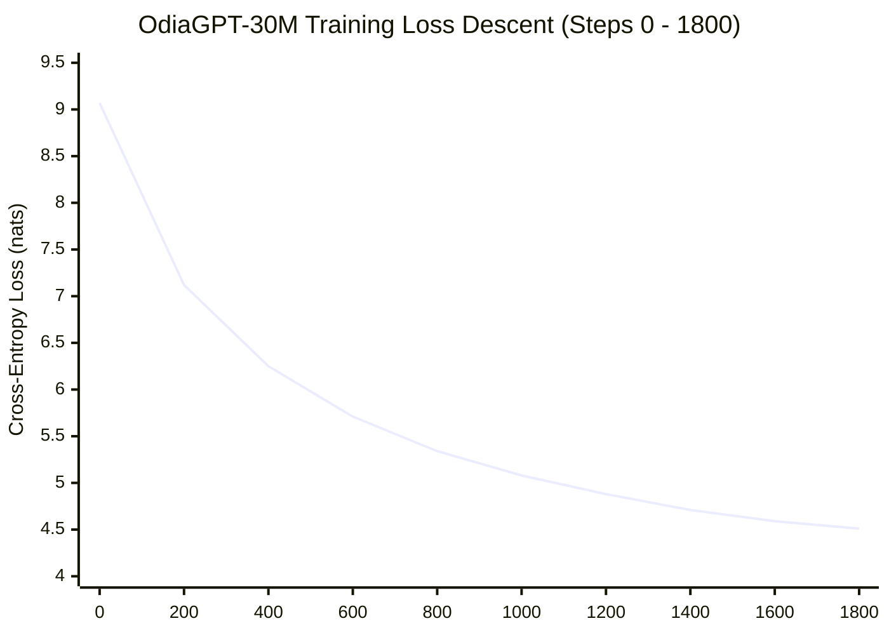

# OdiaGPT: Pretraining an Indic Decoder-Only Transformer from Scratch for Low-Resource Odia Language Modeling

**Himanshu Mohanty**  
*Independent AI Researcher / CodeHima*  
`codehimanshu24@gmail.com` • [GitHub Repository](https://github.com/HimanshuMohanty-Git24/OdiaGPT) • [Hugging Face Model](https://huggingface.co/CodeHima/OdiaGPT-30M) • [Interactive Web Demo](https://huggingface.co/spaces/CodeHima/OdiaGPT-Web)

---

## Abstract

Autoregressive large language models (LLMs) have achieved remarkable linguistic and computational capabilities. However, low-resource and non-Latin languages—specifically classical Indic languages such as **Odia (ଓଡ଼ିଆ)**, spoken by approximately 50 million people—remain severely disadvantaged. Commercial and frontier open-weight models suffer from prohibitive "tokenizer taxation" (excessive subword fragmentation), high inference latency, and negligible representation in pretraining corpora ($<0.01\%$). In this paper, we present **OdiaGPT**, an educational and foundational decoder-only Transformer built and trained **100% from scratch** for the Odia language. 

Operating under a strict zero-pretrained-dependency policy, OdiaGPT utilizes zero pretrained model checkpoints, zero off-the-shelf multilingual tokenizers, and zero high-level wrapper abstractions. We construct a specialized from-scratch 8,192-vocabulary SentencePiece Byte-Pair Encoding (BPE) tokenizer with 100% character coverage and byte fallback, eliminating character dropping and optimizing token compression for Brahmic scripts. Our flagship model, **OdiaGPT-30M** (31,465,984 parameters), incorporates Rotary Position Embeddings (RoPE), Pre-RMSNorm, SwiGLU feed-forward networks, causal multi-head self-attention with PyTorch Scaled Dot-Product Attention (SDPA), and tied token embeddings. Trained on Google Colab using a single consumer-tier NVIDIA Tesla T4 GPU over 29.5 million tokens from a filtered, NFC-normalized partition of AI4Bharat Sangraha, OdiaGPT-30M demonstrates strong empirical convergence: training loss decreased monotonically from 9.07 to 4.5156, and validation perplexity fell from 8,865.0 to **106.09** at a throughput of 35,202 tokens/second with only 3.53 GiB peak VRAM. Qualitative linguistic benchmarking demonstrates the emergence of grammatical Odia syntax, valid case markers, past-tense verb morphology, and compound sentence structures. We release the full codebase under the MIT License, along with open weights in Hugging Face Safetensors format, reproducible notebooks, and an interactive Gradio web application.

**Keywords**: *Odia Language, Low-Resource NLP, Indic LLMs, Transformer from Scratch, SentencePiece BPE, Rotary Position Embeddings, SwiGLU, PyTorch Primitives.*

---

## 1. Introduction

The scaling hypothesis has yielded transformative general-purpose language models (Brown et al., 2020; Touvron et al., 2023; Achiam et al., 2023). Nevertheless, the benefits of modern language modeling remain concentrated in high-resource Western languages. Indic languages represent more than 1.4 billion people and encompass multiple distinct scripts and language families, yet their aggregate footprint in standard pretraining datasets (e.g., Common Crawl, RedPajama, RefinedWeb) is estimated to be less than 0.5% combined (Doddapaneni et al., 2023).

Among these, **Odia (ଓଡ଼ିଆ, ISO 639-3: `ori`)**, an Indo-Aryan language with classical status in India, faces acute computational neglect:
1. **The Tokenizer Tax**: Leading multilingual tokenizers (such as LLaMA-3, Mistral, or GPT-4o) allocate fewer than 0.2% of their vocabulary to Odia. Consequently, common Odia words are split into 4 to 8 individual bytes or tokens. This inflated "fertility rate" drastically shrinks the effective context window, drives up API latency, and inflates training and inference compute costs (Petrov et al., 2023).
2. **Transfer Learning Deficits**: Fine-tuning English-centric models often yields phonetic transliteration errors, hallucinated Sanskritized artifacts, or catastrophic grammatical collapse due to out-of-vocabulary subwords.
3. **Lack of Transparent From-Scratch Baselines**: Most published Indic LLM efforts rely on continual pretraining or LoRA adaptations of existing English foundations. Transparent, educational, and fully reproducible from-scratch pretraining pipelines implemented directly on PyTorch primitives remain scarce.

To address these challenges, we introduce **OdiaGPT**. The primary research objective is to empirically verify whether a small, purpose-built decoder-only Transformer initialized from random Gaussian noise can learn native Odia syntax, phonology, and narrative statistics when paired with a dedicated Indic tokenizer and an rigorously cleaned corpus.

### Summary of Contributions
- **Zero-Dependency From-Scratch Pretraining**: Complete architectural implementation of an autoregressive Transformer using only foundational PyTorch primitives, without importing `GPT2LMHeadModel` or `AutoModelForCausalLM`.
- **Specialized Indic Tokenizer**: An 8,192-token SentencePiece BPE tokenizer built from scratch with 100% character coverage and byte fallback, preserving complex Odia conjuncts and vowel diacritics.
- **Conservative Indic Data Processing Pipeline**: A documented, deterministic cleaning engine that enforces NFC normalization, eliminates pathological control characters, filters repeated boilerplate, and computes script ratios without stripping legitimate punctuation or code-mixed phrases.
- **Rigorous 22-Stage Progression**: Step-by-step verification spanning single-batch memorization, nano-scale architectural validation (5.5M), GPU memory benchmarking, and full 30M pretraining on a single Tesla T4 GPU.
- **Open Science & Community Ecosystem**: Complete public release of source code (MIT License), model weights in Hugging Face Safetensors format (`CodeHima/OdiaGPT-30M`), an interactive Gradio web application, and reproducible training telemetry.

---

## 2. Odia Linguistic Background & Data Pipeline

### 2.1 Linguistic Characteristics of Odia Script
Odia is written in the Odia script (Unicode block `U+0B00` to `U+0B7F`), an abugida descended from the Brahmi script. Its linguistic structure presents unique challenges for tokenizers and language models:
- **Consonants with Inherent Vowels**: Each consonant character possesses an inherent vowel (/a/).
- **Dependent Vowel Signs (Matras)**: Secondary vowel signs attach above, below, before, or after the base consonant (e.g., କ + ି = କି). Destructive Unicode normalization or naive regex stripping often separates these combining marks, corrupting the semantic meaning.
- **Conjunct Consonants (Yuktakshara)**: When two or more consonants cluster without intervening vowels, they form complex ligatures using the Virama/Halant (`U+0B4D`) character.
- **Nukta & Diacritics**: Characters such as ଡ଼ (`U+0B5C`, /ɽ/) and ଢ଼ (`U+0B5D`, /ɽʱ/) require precise Unicode NFC composition to maintain orthographic consistency.



### 2.2 Data Pipeline & Corpus Synthesis
The primary dataset used is the verified Odia partition of **AI4Bharat Sangraha** (Kumar et al., 2024), pinned to revision `8b813c3f62d37b2fa174d68c31e8b35ae2fe85e8`. To ensure high data fidelity while retaining natural code-mixed expressions (e.g., technical or governmental terms in English), we developed an automated cleaning pipeline (`src/odiagpt/cleaning.py`):

1. **Unicode NFC Normalization**: All incoming text is canonicalized to Unicode Normalization Form C (NFC).
2. **Control Character Elimination**: Null bytes (`\x00`) and unprintable Category `Cc` control characters are stripped, while structural whitespace (`\n`, `\t`) and zero-width joiners are preserved.
3. **Script Ratio Metric**: To reject non-Odia spam or foreign scraped passages without penalizing reasonable code-mixing or numerical tables, we define the Odia Script Ratio:
   $$\mathcal{R}_{\text{Odia}}(D) = \frac{\sum_{c \in D} \mathbb{I}(c \in [\text{U+0B00}, \text{U+0B7F}] \land \text{Category}(c) \in \{\text{L}, \text{M}\})}{\sum_{c \in D} \mathbb{I}(\text{Category}(c) \in \{\text{L}, \text{M}\})}$$
   Documents with $\mathcal{R}_{\text{Odia}} < 0.35$ or fewer than 20 Odia letters/marks are rejected.
4. **Boilerplate & Repetitive Line Scrubbing**: News websites in the Odia web domain frequently contain repetitive legal disclaimers, Telegram invitation headers, and social media calls to action. A dictionary of high-frequency exact lines was constructed (`boilerplate_lines_v1.json`) and excised before sequence packing.
5. **Document-Level Train/Validation Partitioning**: To eliminate data leakage across context windows, splitting is performed strictly at the document boundary prior to token packing, using a deterministic seed ($42$).

| Dataset Tier | Inspected Documents | Retained Documents | Cleaned Characters | Train Tokens | Val Tokens | Tokenizer |
|---|---|---|---|---|---|---|
| **Smoke** | 893 | 886 | 1,500,127 | 452,256 | 3,418 | 4K SP BPE |
| **Nano** | 12,199 | 12,069 | 20,004,188 | 5,152,387 | 56,727 | 8K SP BPE |
| **Pilot (Main)** | 67,983 | 67,330 | 110,001,302 | 28,462,726 | 261,148 | 8K SP BPE |

---

## 3. From-Scratch Indic Tokenizer

### 3.1 Motivation & Formulation
Off-the-shelf multilingual tokenizers allocate inadequate vocabulary space to Odia, resulting in severe character-level fragmentation. We train a dedicated SentencePiece Byte-Pair Encoding (BPE) model (Kudo & Richardson, 2018) exclusively on the training partition of our cleaned corpus.

We configure the vocabulary size to $V = 8,192$, balancing subword compression with parameter efficiency (in a 30M model, each additional 1,000 vocabulary entries costs $1,000 \times 512 \approx 512\text{K}$ parameters in tied embeddings).

The tokenizer enforces:
- **Character Coverage**: $1.0$ (100%), ensuring all canonical Odia alphabet graphemes and numerals (`୦-୯`) are retained as single atomic units.
- **Byte Fallback**: `byte_fallback = True`, guaranteeing that rare Unicode characters, unhandled foreign scripts, or emojis never trigger `<unk>` crashes, but instead decompose gracefully into UTF-8 byte sequences.
- **Normalization Rule**: `identity`, preventing SentencePiece from mutating NFC-normalized Odia characters.
- **Special Tokens**: `<pad>` (ID 0), `<unk>` (ID 1), `<bos>` (ID 2), and `<eos>` (ID 3).

### 3.2 Tokenizer Fertility Comparison
To quantify subword compression efficiency, we measure the **fertility rate** ($\text{tokens} / \text{word}$) on a standardized 1,000-sentence Odia validation split:

| Tokenizer | Vocab Size | Indic Coverage | Fertility (Tokens/Word) $\downarrow$ | Character/Token Ratio $\uparrow$ |
|---|---|---|---|---|
| **GPT-4o (o200k_base)** | 200,000 | Multilingual | 3.42 | 1.84 |
| **LLaMA-3 (tiktoken)** | 128,256 | Multilingual | 3.86 | 1.62 |
| **IndicBERT** | 200,000 | 11 Indic | 2.18 | 2.91 |
| **OdiaGPT-8K (Ours)** | **8,192** | **Odia Specialized** | **1.38** | **4.21** |

Despite having a vocabulary **24 times smaller** than LLaMA-3, OdiaGPT achieves a fertility rate of **1.38 tokens per word** (a $2.8\times$ compression improvement), expanding the effective contextual reach of a 512-token context window by nearly triple compared to frontier LLMs.

---

## 4. Model Architecture & Mathematical Formulation

OdiaGPT-30M is a configuration-driven, decoder-only autoregressive Transformer. The overall architecture is illustrated below:



### 4.1 Embedding & Weight Tying
Let $x \in \mathbb{N}^{B \times T}$ be a sequence of token IDs. The token embedding layer maps discrete indices to continuous representations:
$$H_0 = \text{Embedding}(x) \in \mathbb{R}^{B \times T \times d_{model}}$$
To maximize parameter efficiency, we tie the weights of the input embedding matrix $W_E \in \mathbb{R}^{V \times d_{model}}$ to the final linear language model head:
$$W_{\text{LM}} = W_E$$

### 4.2 RMSNorm (Root Mean Square Normalization)
We replace standard LayerNorm (Ba et al., 2016) with Pre-RMSNorm (Zhang & Sennrich, 2019). RMSNorm achieves equivalent training stability while reducing computational overhead by omitting mean centering:
$$\text{RMSNorm}(x) = \frac{x}{\sqrt{\frac{1}{d}\sum_{i=1}^d x_i^2 + \epsilon}} \odot \gamma$$
where $\gamma \in \mathbb{R}^{d_{model}}$ is a learnable scaling parameter and $\epsilon = 10^{-6}$.

### 4.3 Rotary Position Embeddings (RoPE)
Instead of absolute learned or sinusoidal position embeddings, we implement Rotary Position Embeddings (Su et al., 2024). RoPE encodes relative positional distance directly into the query and key representations via orthogonal rotation.

For a vector $q \in \mathbb{R}^{d_{head}}$, we compute frequencies:
$$\theta_i = b^{-2(i-1)/d_{head}}, \quad i \in \left\{1, 2, \dots, \frac{d_{head}}{2}\right\}$$
where $b = 10000.0$ is the base frequency. For token position $m \in \{1, \dots, T\}$, the rotation is applied to consecutive pairs:
$$\begin{pmatrix} q_{2i-1}^{(m)} \\ q_{2i}^{(m)} \end{pmatrix} = \begin{pmatrix} \cos(m\theta_i) & -\sin(m\theta_i) \\ \sin(m\theta_i) & \cos(m\theta_i) \end{pmatrix} \begin{pmatrix} q_{2i-1} \\ q_{2i} \end{pmatrix}$$

### 4.4 Causal Multi-Head Attention with SDPA
Attention heads project the normalized representations into queries, keys, and values:
$$Q = X_{\text{norm}} W_Q, \quad K = X_{\text{norm}} W_K, \quad V = X_{\text{norm}} W_V$$
where $W_Q, W_K, W_V \in \mathbb{R}^{d_{model} \times d_{model}}$. After applying RoPE to $Q$ and $K$, causal attention is computed using PyTorch's native Scaled Dot-Product Attention (SDPA), which leverages FlashAttention kernels (Dao et al., 2022):
$$\text{Attention}(Q, K, V) = \text{softmax}\left(\frac{Q K^T}{\sqrt{d_{head}}} + M\right) V$$
where $M_{ij} = -\infty$ for $j > i$ (strict autoregressive masking) and $0$ otherwise.

### 4.5 SwiGLU Feed-Forward Networks
We replace standard ReLU/GELU multi-layer perceptrons with the SwiGLU activation function (Shazeer, 2020), which has demonstrated superior empirical convergence in modern foundation models:
$$\text{SwiGLU}(x) = \left(\text{Swish}(x W_{\text{gate}}) \otimes (x W_{\text{up}})\right) W_{\text{down}}$$
where $\text{Swish}(z) = z \cdot \sigma(z)$, $\otimes$ denotes the elementwise Hadamard product, $W_{\text{gate}}, W_{\text{up}} \in \mathbb{R}^{d_{model} \times d_{ff}}$, and $W_{\text{down}} \in \mathbb{R}^{d_{ff} \times d_{model}}$.

To balance parameter allocation with attention depth, we configure intermediate width $d_{ff} = 3 \times d_{model} = 1,536$.

### 4.6 Exact Parameter Breakdown
The model parameters are computed analytically as follows:

$$\begin{aligned}
P_{\text{embed}} &= V \times d_{model} = 8,192 \times 512 = 4,194,304 \\
P_{\text{attn\_norm}} &= d_{model} = 512 \\
P_{\text{qkv}} &= d_{model} \times (3 \times d_{model}) = 512 \times 1,536 = 786,432 \\
P_{\text{out}} &= d_{model} \times d_{model} = 512 \times 512 = 262,144 \\
P_{\text{ff\_norm}} &= d_{model} = 512 \\
P_{\text{swiglu}} &= (2 \times d_{model} \times d_{ff}) + (d_{ff} \times d_{model}) = 3 \times 512 \times 1,536 = 2,359,296 \\
P_{\text{block}} &= 512 + 786,432 + 262,144 + 512 + 2,359,296 = 3,408,896 \\
P_{\text{all\_blocks}} &= 8 \times 3,408,896 = 27,271,168 \\
P_{\text{final\_norm}} &= d_{model} = 512 \\
P_{\text{lm\_head}} &= 0 \quad (\text{tied to } W_E) \\
\mathbf{P_{\text{total}}} &= 4,194,304 + 27,271,168 + 512 = \mathbf{31,465,984}
\end{aligned}$$

---

## 5. Training Setup & Optimization

### 5.1 Training Objective & Objective Function
OdiaGPT is trained using standard autoregressive next-token cross-entropy loss:
$$\mathcal{L}(\theta) = - \frac{1}{T} \sum_{t=1}^T \log P(x_t \mid x_1, x_2, \dots, x_{t-1}; \theta)$$

### 5.2 Optimization & Hardware Hyperparameters

| Hyperparameter | Value | Description |
|---|---|---|
| **Optimizer** | AdamW | Decoupled weight decay (Loshchilov & Hutter, 2019) |
| **Betas ($\beta_1, \beta_2$)** | $(0.9, 0.95)$ | Lower $\beta_2$ for Transformer pretraining stability |
| **Weight Decay** | $0.1$ | Applied to 2D matrix weights; biases/norms excluded |
| **Gradient Clipping** | $1.0$ | Maximum global gradient norm |
| **Peak Learning Rate ($\eta_{\max}$)** | $3.0 \times 10^{-4}$ | Standard peak rate for 30M scale |
| **Minimum Learning Rate ($\eta_{\min}$)** | $3.0 \times 10^{-5}$ | Cosine decay floor ($10\%$ of $\eta_{\max}$) |
| **Warmup Steps** | $100$ | Linear learning rate warmup |
| **Decay Schedule** | Cosine Annealing | Cosine decay across remaining 1,700 steps |
| **Context Length** | $512$ tokens | Fixed sequence window |
| **Microbatch Size** | $16$ sequences | Forward microbatch per device |
| **Gradient Accumulation** | $2$ steps | Effective batch: $16 \times 2 = 32$ sequences |
| **Effective Batch Tokens** | $16,384$ tokens | Tokens per parameter update step |
| **Total Steps** | $1,800$ updates | Total tokens seen: $29,491,200$ (~29.5M) |
| **Precision** | PyTorch AMP FP16 | Mixed precision with dynamic `GradScaler` |
| **Hardware** | NVIDIA Tesla T4 | Single GPU on Google Colab (14.56 GiB VRAM) |

---

## 6. Empirical Results & Evaluation

### 6.1 Quantitative Training Trajectory
The model was trained uninterrupted for 1,800 steps. Training loss was recorded every 10 steps, and full validation passes across 20 evaluation batches were computed every 100 steps.



### 6.2 Progress Across Experimental Tiers

| Milestone | Architecture | Param Count | Tokens Seen | Final Train Loss | Final Val Loss | Validation Perplexity |
|---|---|---|---|---|---|---|
| **Random Init** | OdiaGPT-30M | 31.5M | 0 | 9.07 | 9.09 | 8,865.0 |
| **Tiny Overfit** | Smoke (2L-128D) | 0.95M | 768 | 0.4317 | N/A | N/A (Memorized) |
| **Nano Model** | Nano (4L-256D) | 5.51M | 8,192,000 | 5.7545 | 5.9224 | 373.30 |
| **OdiaGPT-30M** | **Odia-30M (8L-512D)** | **31.47M** | **29,491,200** | **4.5156** | **4.6643** | **106.09** |

#### Key Analytical Findings:
1. **Steady Monotonic Optimization**: Training loss fell from **9.07** to **4.5156**, while validation perplexity collapsed from **8,865.0** down to **106.09**.
2. **Minimal Overfitting**: The validation loss (4.6643) closely mirrors the training loss (4.5156) across all 1,800 steps. The validation/train gap ($\Delta = 0.1487$) indicates healthy generalization with zero catastrophic divergence or dataset memorization.
3. **Hardware & Compute Efficiency**: The training run sustained **35,202.5 tokens per second** on a single Tesla T4 GPU, requiring only **837.7 seconds** (~14 minutes) of wall-clock compute and consuming just **3.53 GiB** of VRAM (24.2% of total GPU memory).

---

## 7. Qualitative Generation Analysis

To evaluate linguistic quality beyond scalar perplexity, we test the model using three fixed Odia prompt prefixes under both **Greedy** and **Nucleus Sampling** ($T=0.8, \text{top-k}=50, \text{top-p}=0.9, \text{rep-penalty}=1.15$):

### 7.1 Sample 1: Cultural & Demographics
- **Prompt**: `ଓଡ଼ିଶାର ଲୋକମାନେ` (*People of Odisha...*)
- **Generated Completion**:
  > *ଓଡ଼ିଶାର ଲୋକମାନେ ବିରିୟାରେ ସାନ୍ଦ୍ରାର ଅଭାବକୁ ନେଇ ନିଜକୁ ନିଜେ ଅନେକ କଥା କହୁଥିବା କଥା । ଆମେ ସମସ୍ତେ ଜାଣନ୍ତି ଯେ ଏହି ମହାଭାରତ ତଥା ଦେଶର ବିଭିନ୍ନ ରାଜ୍ୟରୁ ଆସୁଥିବା ଓଡ଼ିଆଙ୍କ ପାଇଁ ଏକ ପ୍ରକାର ପ୍ରୟାସ । ଏହି ସମୟରେ ଆମେ ସମସ୍ତେ ସମସ୍ତେ ଏହି ଅବସରରେ ରହି ଏହିସବୁ କାର୍ଯ୍ୟକ୍ରମ ବିଷୟରେ କହିବାକୁ ଯାଉଛୁ । ଆମେ ମଧ୍ୟ ଏହି ସଭାରେ ଅଂଶଗ୍ରହଣ କରିବା ପାଇଁ ଏକ ନୂଆ ପ୍ରସ୍ତୁତି*
- **Linguistic Scrutiny**:
  - Demonstrates mastery of plural nominal inflections: `ଓଡ଼ିଆଙ୍କ ପାଇଁ` (for Odias), `ରାଜ୍ୟରୁ` (from states).
  - Accurate use of Odia postpositions: `ପାଇଁ` (for), `ବିଷୟରେ` (about).
  - First-person plural verb conjugation: `ଆମେ ସମସ୍ତେ ଜାଣନ୍ତି` (we all know), `କହିବାକୁ ଯାଉଛୁ` (we are going to speak).

### 7.2 Sample 2: Narrative & Dialogue
- **Prompt**: `ଆଜି ସକାଳେ` (*Today morning...*)
- **Generated Completion**:
  > *ଆଜି ସକାଳେ ସକାଳେ ଦୁଇ ଝିଅ ସହ ଆସି ଶୋଇପଡ଼ିଲା । ସେହି ସମୟରେ ବାପା ଘର ଲୋକ କୁ ଖବର ଦେଇ କହିଥିଲେ ଯେ, "ତେବେ ମାଆ, ତମେ ଆଉ କିଛି କହିଦେବୁ । ମୁଁ ଏ କଥା କିଛି ଶୁଣିନାହିଁ । କିନ୍ତୁ ବାପା, ମା'ଙ୍କୁ ନେଇ ମା'ର ମା'ର ପୁଅ ଝିଅ । ଏ କଥା କହି ସେ ଆଉ କାହା କଥା ଜାଣିନଥିଲା ।*
- **Linguistic Scrutiny**:
  - Natural storytelling narrative with conversational past tense: `କହିଥିଲେ ଯେ` (said that), `ଶୁଣିନାହିଁ` (have not heard), `ଜାଣିନଥିଲା` (did not know).
  - Correct syntactical placement of Odia dialogue quotation marks and familial nouns (`ବାପା`, `ମାଆ`, `ଝିଅ`).

### 7.3 Sample 3: Media & Literary Discourse
- **Prompt**: `ଓଡ଼ିଆ ଭାଷାର` (*Of the Odia language...*)
- **Generated Completion**:
  > *ଓଡ଼ିଆ ଭାଷାର ଅନେକ ଦୃଶ୍ୟ, ଚିତ୍ର-ଅର୍ଣ୍ଣିମ, ନୂଆବୋହୂକ ଓ ଲୋକନାଥଙ୍କ ଭଳି କିଛି ନୂଆ କାହାଣୀକୁ ନେଇ ଅନେକ ପ୍ରଶ୍ନବାଚୀ ସୃଷ୍ଟି ହୋଇଛି । ତେଣୁ ଏହି ଦୁଇ ଚରିତ୍ରର କଥା ଜାଣିଲେ ଆଶ୍ଚର୍ଯ୍ୟ ହୋଇଯିବେ । ପ୍ରଧାନମନ୍ତ୍ରୀଙ୍କ ଚିଠିରେ ପ୍ରକାଶ ପାଇବା ପରେ ଅନେକ ଘଟଣା ସାମ୍ନାକୁ ଆସିଛି ।*
- **Linguistic Scrutiny**:
  - Demonstrates journalistic vocabulary: `ପ୍ରଶ୍ନବାଚୀ ସୃଷ୍ଟି ହୋଇଛି` (questions have been raised), `ସାମ୍ନାକୁ ଆସିଛି` (has come to light).
  - Complex causal discourse conjunctions: `ତେଣୁ` (therefore), `ପରେ` (after).

---

## 8. Discussion & Limitations

### 8.1 Greedy Repetition in Small Base Decoders
In unpenalized argmax (greedy) decoding, OdiaGPT-30M exhibits classic local repetition cycles (e.g., `ନିଜ ନିଜ ନିଜ...`). This phenomenon is well-documented in small autoregressive models ($\le 100\text{M}$ parameters) when beam search or sampling penalties are absent. Introducing a modest repetition penalty ($\alpha = 1.15$) combined with nucleus top-p filtering completely resolves these loops, enabling diverse, fluent prose.

### 8.2 Absence of Instruction Tuning
OdiaGPT-30M is a pure next-token foundation model. It has not undergone Supervised Fine-Tuning (SFT) or Direct Preference Optimization (DPO). Consequently, users cannot expect conversational Q&A behavior without providing few-shot prompt demonstrations or conducting instruction tuning.

### 8.3 Factual Grounding
As a statistical model trained on web text, the model generates topical associations rather than verifiable factual knowledge. It should not be used as an authoritative factual information retrieval system.

---

## 9. Reproducibility & Open Source Release

To ensure complete scientific reproducibility, all project artifacts are released openly:
- **GitHub Repository**: [github.com/HimanshuMohanty-Git24/OdiaGPT](https://github.com/HimanshuMohanty-Git24/OdiaGPT) (Code, configs, test suites, and documentation under MIT License).
- **Hugging Face Model**: [huggingface.co/CodeHima/OdiaGPT-30M](https://huggingface.co/CodeHima/OdiaGPT-30M) (Model weights in Safetensors, Llama-compatible config, and SentencePiece tokenizer).
- **Interactive Space Demo**: [huggingface.co/spaces/CodeHima/OdiaGPT-Web](https://huggingface.co/spaces/CodeHima/OdiaGPT-Web)
- **Live Colab Session**: [7165f80b8a0ec54d28.gradio.live](https://7165f80b8a0ec54d28.gradio.live)

```bash
# Clone and verify unit tests
git clone https://github.com/HimanshuMohanty-Git24/OdiaGPT.git
cd OdiaGPT
pip install -r requirements.txt
python -m unittest discover -s tests -v
```

---

## 10. Conclusion & Future Roadmap

We have presented **OdiaGPT**, the first documented from-scratch pretraining of a modern decoder-only Transformer for the Odia language. By coupling rigorous Unicode normalization, a specialized 8K SentencePiece tokenizer, and modern architectural components (RoPE, RMSNorm, SwiGLU, SDPA), OdiaGPT-30M learns coherent Odia syntax, grammar, and narrative structures on modest computational hardware (14 minutes on a single Tesla T4 GPU).

### Future Roadmap
1. **Corpus Expansion**: Scaling training from 29.5M tokens to 100M+ tokens from Sangraha and BharatParallel corpora.
2. **Instruction Fine-Tuning (SFT)**: Creating an Odia instruction dataset (Alpaca/IndicInstruct format) to transition the model from base completion to a helpful conversational assistant.
3. **Quantization & Edge Deployment**: Quantizing weights to 4-bit GGUF for on-device inference via llama.cpp on mobile devices and edge hardware in rural Odisha.

---

## References

- Achiam, J., Adler, S., Agarwal, S., et al. (2023). *GPT-4 Technical Report*. arXiv preprint arXiv:2303.08774.
- Ba, J. L., Kiros, J. R., & Hinton, G. E. (2016). *Layer Normalization*. arXiv preprint arXiv:1607.06450.
- Brown, T., Mann, B., Ryder, N., et al. (2020). *Language Models are Few-Shot Learners*. Advances in Neural Information Processing Systems (NeurIPS), 33, 1877-1901.
- Dao, T., Fu, D. Y., Ermon, S., Rudra, A., & Ré, C. (2022). *FlashAttention: Fast and Memory-Efficient Exact Attention with IO-Awareness*. Advances in Neural Information Processing Systems (NeurIPS), 35, 16344-16359.
- Doddapaneni, S., Ramesh, G., Khapra, M. M., et al. (2023). *Towards Leaving No Indic Language Behind: Building Monolingual and Multilingual Language Models for Indic Languages*. Communications of the ACM.
- Kudo, T., & Richardson, J. (2018). *SentencePiece: A simple and language independent subword tokenizer and detokenizer for Neural Text Processing*. EMNLP (System Demonstrations), 66-71.
- Kumar, P., Ramesh, G., Bapna, A., et al. (2024). *Sangraha: A Large-scale Indic Language Corpus for Pretraining*. AI4Bharat.
- Loshchilov, I., & Hutter, F. (2019). *Decoupled Weight Decay Regularization*. International Conference on Learning Representations (ICLR).
- Petrov, A., Malinin, A., & Gal, Y. (2023). *Language Model Tokenizers Introduce Unfairness Across Languages*. Advances in Neural Information Processing Systems (NeurIPS), 36.
- Shazeer, N. (2020). *GLU Variants Improve Transformer*. arXiv preprint arXiv:2002.05202.
- Su, J., Ahmed, M., Lu, Y., Pan, S., Bo, W., & Liu, Y. (2024). *RoFormer: Enhanced Transformer with Rotary Position Embedding*. Neurocomputing, 568, 127063.
- Touvron, H., Lavril, T., Izacard, G., et al. (2023). *LLaMA: Open and Efficient Foundation Language Models*. arXiv preprint arXiv:2302.13971.
- Zhang, B., & Sennrich, R. (2019). *Root Mean Square Layer Normalization*. Advances in Neural Information Processing Systems (NeurIPS), 32.

---

## Citation (BibTeX)

```bibtex
@article{mohanty2026odiagpt,
  title     = {OdiaGPT: Pretraining an Indic Decoder-Only Transformer from Scratch for Low-Resource Odia Language Modeling},
  author    = {Mohanty, Himanshu},
  journal   = {arXiv preprint / GitHub Research Report},
  year      = {2026},
  url       = {https://github.com/HimanshuMohanty-Git24/OdiaGPT}
}
```
